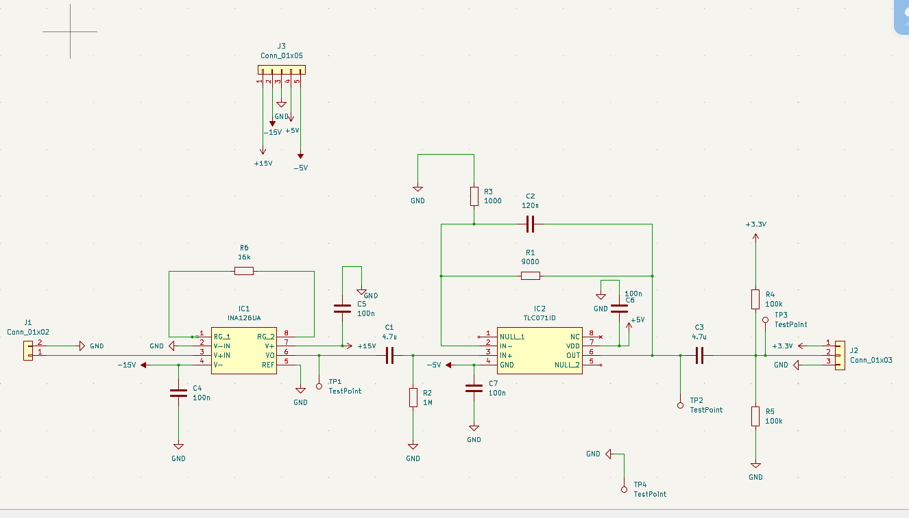
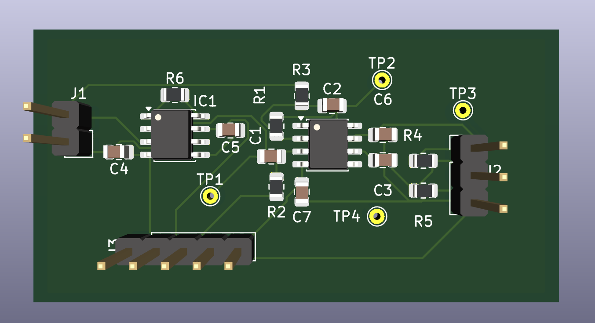

# ecg-frontend-pcb
Compact 2-layer ECG analog front-end PCB designed in KiCad (INA126UA + TLC071ID + 1.65V ESP32 level shifter)
# ECG Analog Front-End PCB (KiCad)

Compact 2-layer PCB (`52 mm × 27 mm`) implementing a two-stage analog front-end for single-lead ECG acquisition, designed in KiCad and verified with **0 DRC errors and 0 warnings**.

## Circuit Architecture
1. **Stage 1 – Instrumentation Amplifier (`IC1: INA126UA`):**
   - Differential amplification with `R6 = 16 kΩ` (`Gain = 10 V/V`, `20 dB`) and high CMRR for 50 Hz common-mode noise rejection.
   - Local `100 nF` ceramic decoupling capacitors placed directly at `±15 V` supply pins.
2. **Stage 2 – Active Band-Pass Filter (`IC2: TLC071ID`):**
   - High-pass corner `~0.034 Hz` (`4.7 µF` + `1 MΩ`) to remove baseline wander, low-pass corner `~147 Hz` (`9 kΩ` || `120 nF`) to attenuate high-frequency noise, and `10×` (`20 dB`) gain (`1 + 9 kΩ / 1 kΩ`).
   - Local `100 nF` decoupling capacitors at `±5 V` supply pins.
3. **Level Shifter (`0–3.3 V` ADC Interface):**
   - AC-coupled (`4.7 µF`) into a `100 kΩ / 100 kΩ` divider biased at `1.65 V` for safe sampling by an `ESP32` ADC.
4. **PCB Layout & Testability:**
   - Solid bottom-layer `GND` plane (`B.Cu`) for noise shielding.
   - Four dedicated test points (`TP1`–`TP4`) for oscilloscope probing at each stage.
   - Production files included in `ecg-frontend-gerbers.zip`.

## Schematic & 3D View

